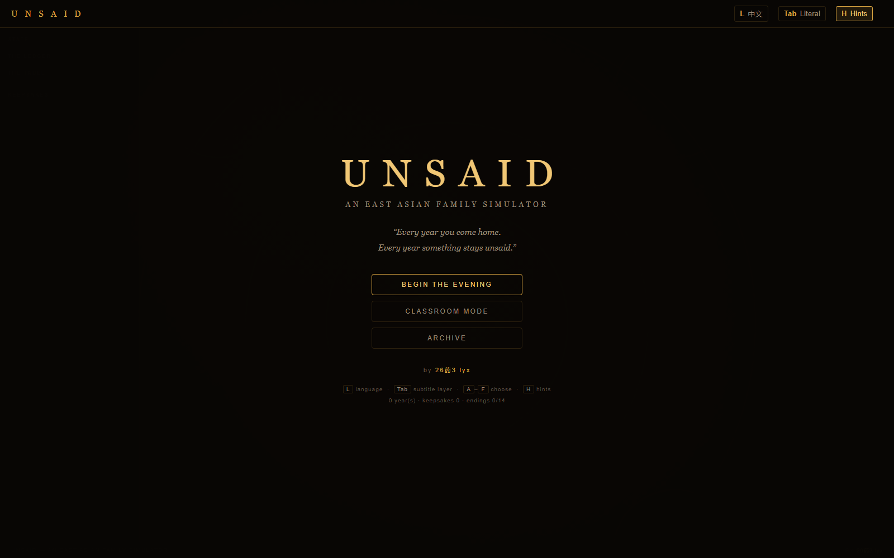
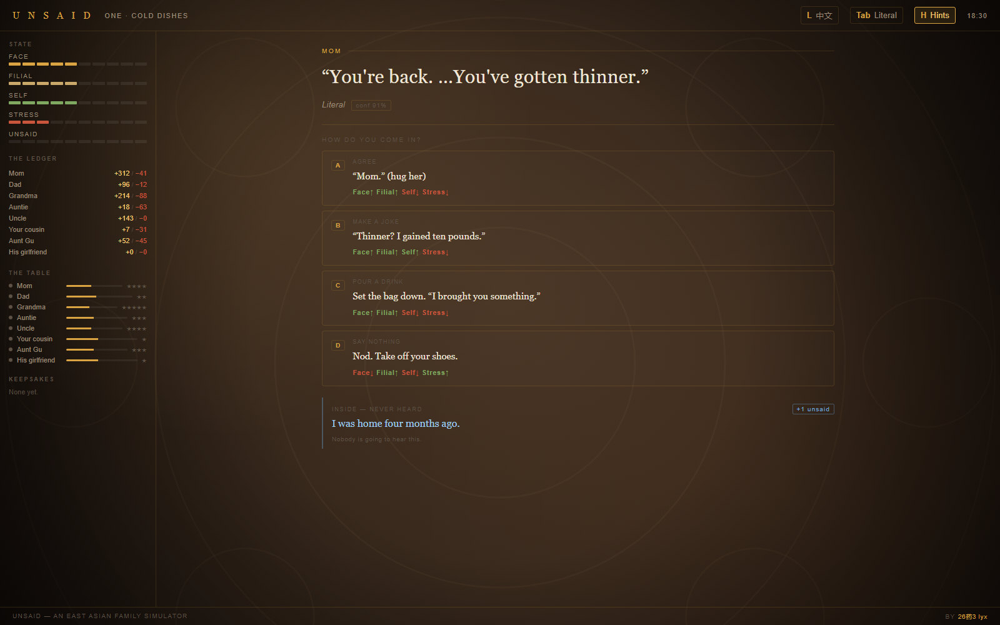
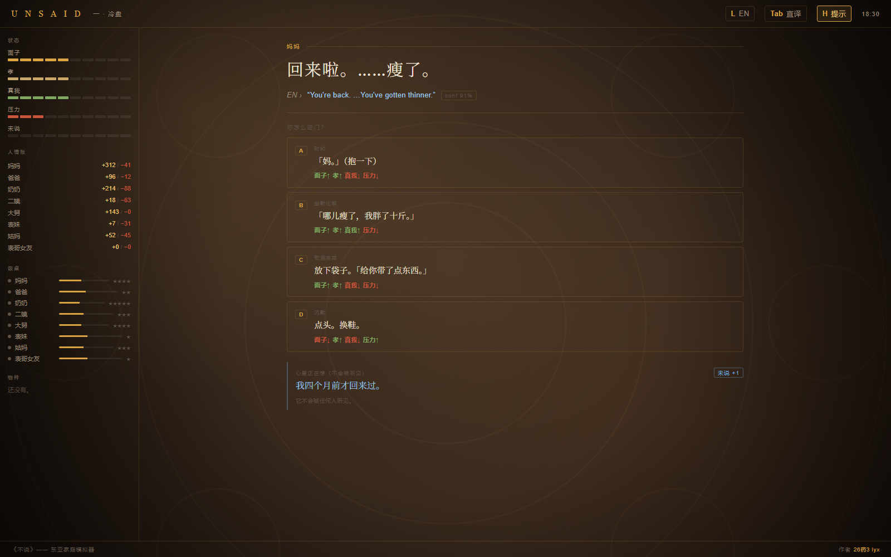
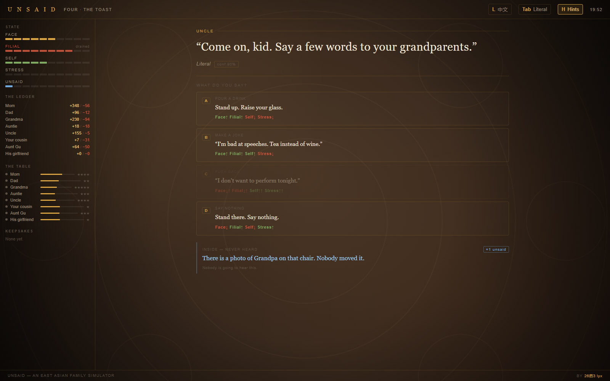
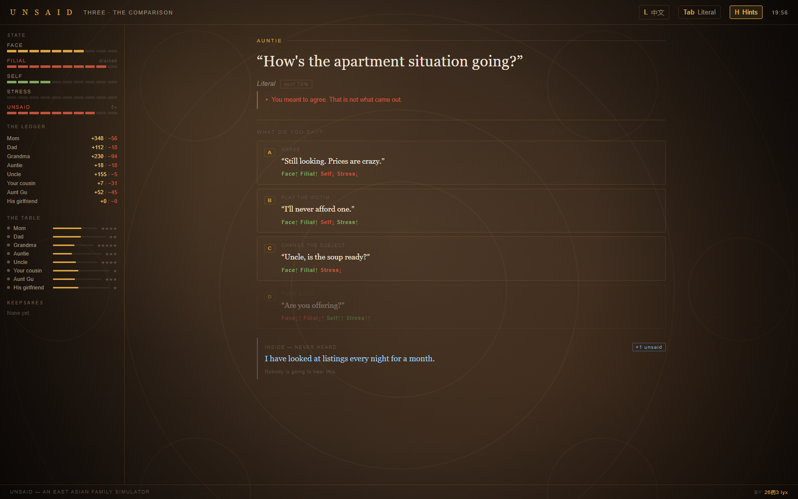
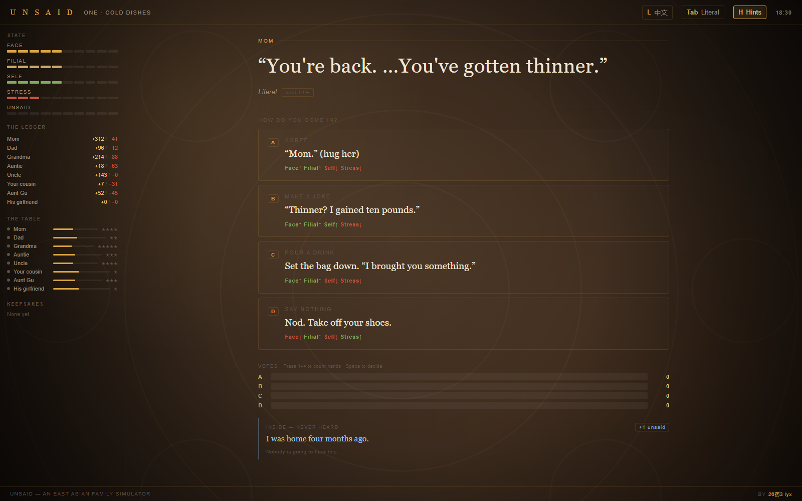

# UNSAID · 年夜饭

> 一年只这一晚。有些话，说出口就收不回来了；有些话，不说，就再也没机会说了。

**UNSAID** 是一款选择驱动的叙事 roguelike 网页游戏：你回到东亚家庭的年夜饭桌上，在五个小时里接住每一句关心、每一次试探，决定哪些话说出口，哪些话留在心里。

**单文件、零依赖、可离线运行** —— 整个游戏就是一个 `index.html`，双击即玩，无需安装任何东西。

## 在线试玩 / Play Online

🎮 发布后的在线链接见本仓库 Releases / 部署说明（或直接用浏览器打开 `index.html`）。

## 游戏截图 / Screenshots

| 标题页 | 开局 | 中文界面 |
|---|---|---|
|  |  |  |

| 旧账 | 通知 | 课堂模式 |
|---|---|---|
|  |  |  |

## 怎么玩 / How to Play

- **目标**：撑过这顿年夜饭。五维状态——面子 face、孝 filial、真我 self、压力 stress、未说 unsaid——任何一端走到极端都危险。
- **接话**：每个回合从若干"动词"中选一种回应方式（开玩笑、转移话题、正面回应、沉默……共 13 种），不同 NPC 对不同话术的接受度各不相同。
- **人情账**：左栏记着你欠谁的、谁欠你的；好感网记着你与每位家人的温度。三年、三件物件，轮回之门会打开。
- **未说**：几乎每个回答都会让"未说"+1。到 5，话开始从侧面漏出来；到 10，决堤。有些年，决堤是这一晚唯一诚实的事。
- **结局**：14 种结局、12 个秘密、10 件物件的元进度，存在浏览器 localStorage 里。
- **语言**：中英双语，顶栏一键切换。
- **新手教程**：首次启动自动播放；随时点右上角 `? Help`（或按 `?` 键）重温。
- **课堂模式**：固定种子 + 举手投票，适合一整间教室一起决定这个家怎么走。

## 本地运行 / Run Locally

不需要构建，不需要服务器：

```bash
# 直接用浏览器打开
index.html
```

或起一个静态服务器：

```bash
npx serve .        # 或 python -m http.server
```

## 仓库结构 / Repository Structure

```
UNSAID/
├── index.html      # 全部游戏：HTML + CSS + JS，单文件零依赖
├── screenshots/    # 游戏截图
├── tools/          # Node.js 回归测试套件（见 tools/README.md）
└── docs/           # 设计文档与测试报告（中文）
```

## 开发 / Development

修改 `index.html` 后必须跑完整回归（契约详见 `tools/README.md`）：

```bash
node tools/dump.js && node tools/audit.js && node tools/domtest.js && \
node tools/mechanics.js && node tools/fixes.js && node tools/balance.js
```

测试套件在 VM 沙盒中加载游戏脚本，校验：状态机流转、13 动词 × 8 NPC 数值表、泄漏/决堤/僵化/误读规则、14 结局全部可达（蒙特卡洛模拟）、i18n 双语键对齐、HTML 模板契约等。

## 技术特点 / Technical Notes

- **单文件架构**：1300+ 行内容数据（话题、涟漪、结局、秘密、物件）与全部逻辑打包在一个 HTML 中，无网络请求，断网可玩。
- **零依赖**：不引入任何框架或 CDN 资源；动画为纯 CSS。
- **确定性测试**：固定种子的调度器与蒙特卡洛结局分布校验，保证数值改动可回归。

## 作者 / Author

**26药3 lyx**

## License

[MIT](LICENSE)
